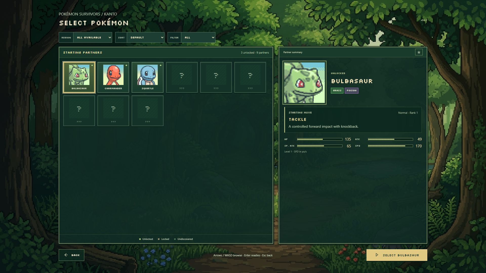
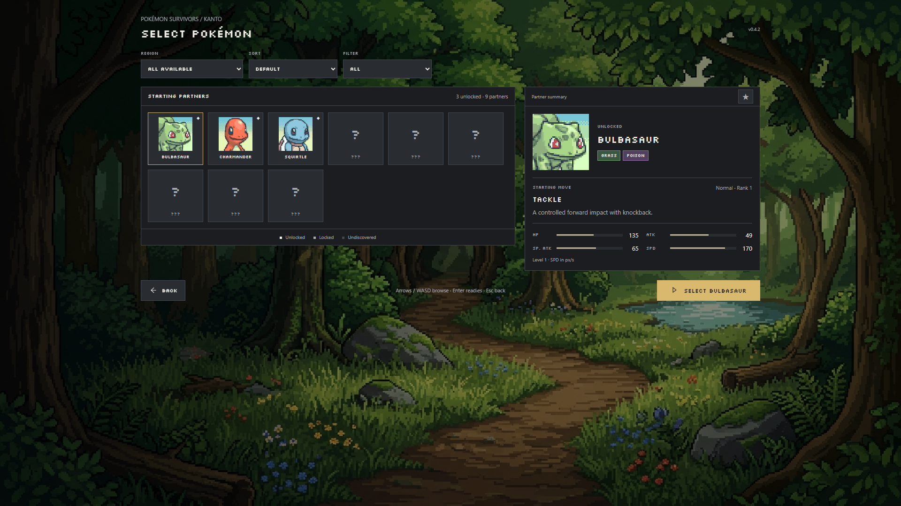
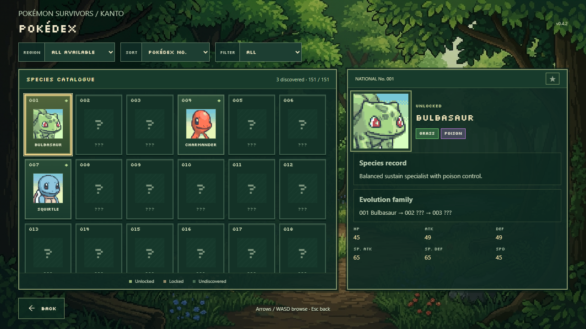
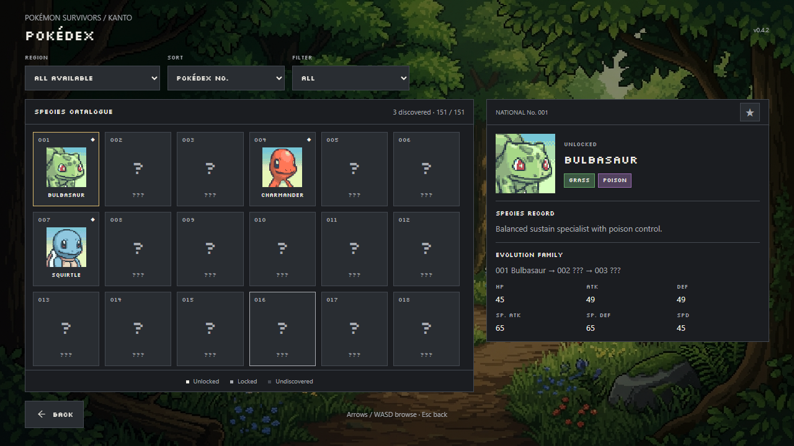
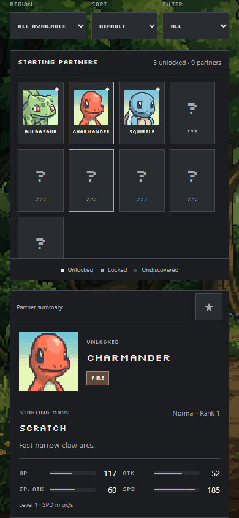
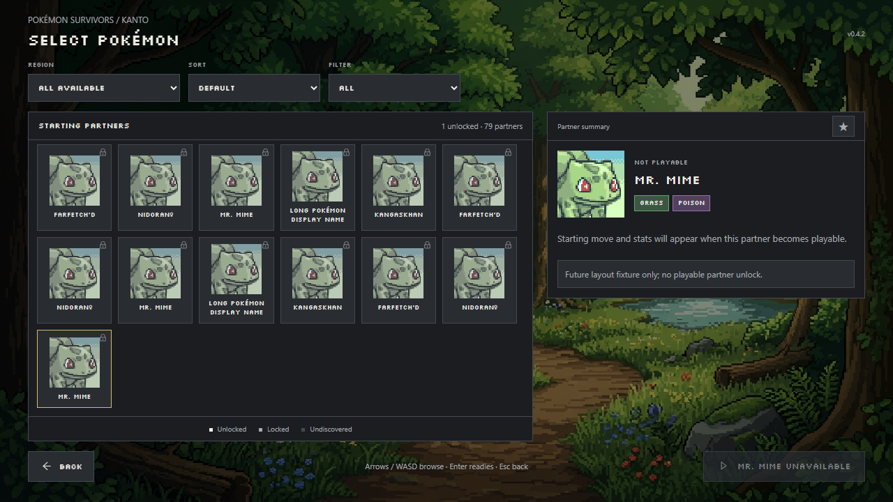

# Minimalist Character Selection and Pokédex

Both roster screens now share a neutral charcoal interface. Flat panels and portrait tiles use `#1B1D21` / `#292D32`, one-pixel `#444951` dividers, `#F1EEE6` primary text and `#A8ABB1` secondary text. The muted-gold `#D9B96E` accent identifies the selection, primary Select action and keyboard/controller focus. Type badges retain their existing type colors.

Panels fit their content instead of stretching down the viewport. The selected summary stays top-aligned, and large catalogues scroll within a bounded roster. Tiles can grow to fit long names. Narrow screens stack the roster and summary, allow page scrolling to the action, and provide 44-pixel touch controls. Stats use flat neutral tracks and restrained warm-gray fills.

The existing animated Viridian Forest remains visible around the panels beneath a neutral translucent black backdrop. Portrait and sprite files, saves, unlock rules, roster membership, starting stats, moves, favorites and navigation code are unchanged. The production character roster still contains the same nine defined base candidates; the 79-entry gallery is a test fixture for future capacity, not new gameplay or unlocks.

## Changed files

| File | Change |
|---|---|
| `src/ui/frontendTokens.css` | Shared neutral palette for frontend components |
| `src/ui/characterRoster.css` | Flat roster/detail surfaces, compact layout, responsive scrolling and focus |
| `src/menu.css` | Shared neutral buttons, focus treatment, subtitle and build-label colors |
| `e2e/charcoalRoster.spec.ts` | Desktop/mobile layout, 79-entry/long-name fixture, states, saves and focus checks |
| `e2e/menuBackground.spec.ts` | Motion capture uses the configured test URL so isolated runs can verify the original animation |

Main-menu composition, logo, artwork and arcade button styles are preserved. Matching reduced-motion 1280 × 720 captures before and after the stylesheet update were pixel-identical.

## Visual review

Before images were captured from commit `0653c43`. The complete review set is in [`qa/charcoal/`](qa/charcoal/).

| Before | After |
|---|---|
|  |  |
|  |  |

## Validation

TypeScript, the production build, 267 unit tests and 35 distinct browser checks passed. The targeted browser set covers character rosters, the new charcoal layouts, shared menus, forest animation and the campaign atlas, including a production launch under `/pkmnsrvrs/`. Checks were run on a separate port with isolated artifacts to avoid concurrent local test output cleanup. Vite retains its existing large-chunk advisory.

Tests cover 1280 × 720 and 1920 × 1080, plus 320-, 390- and 768-pixel narrow layouts; existing roster regressions also cover 1600 × 900 and 2560 × 1440. Desktop panels/actions fit without root scrolling, and narrow layouts can scroll to and activate the action without horizontal overflow. Every name in the 79-entry fixture fits its tile, and keyboard scrolling keeps the selected tile fully inside the grid. Legacy states, favorite persistence, native dropdowns, keyboard/controller confirmation and Back retain their existing behavior.

`desktop-diagnostics.json` records panel bounds and computed palette colors. `main-menu-comparison.json` records the pixel-identical before/after main-menu comparison. Motion checks confirm that localized foliage, ripples and lighting still animate, honor reduced motion and release resources when leaving a screen.
