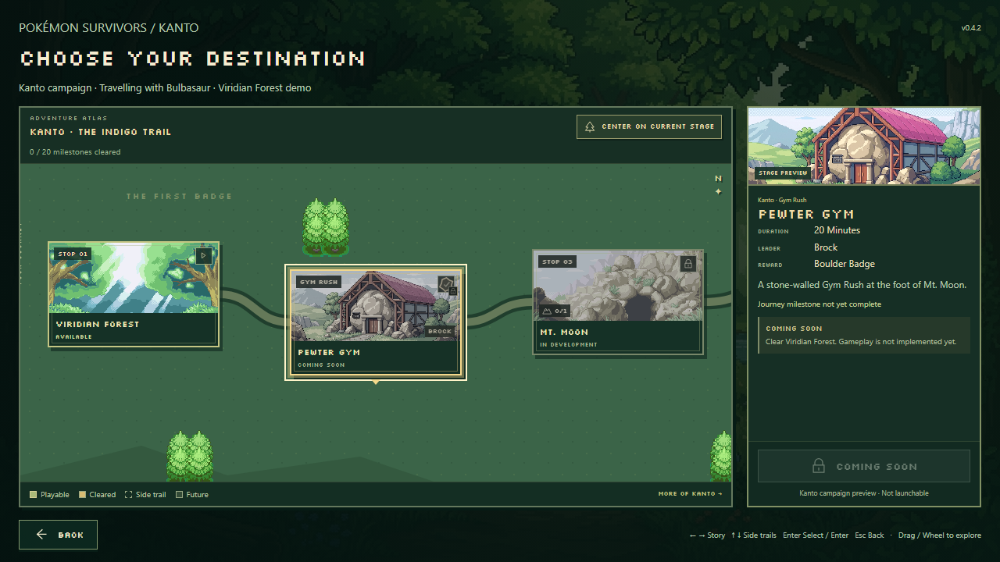
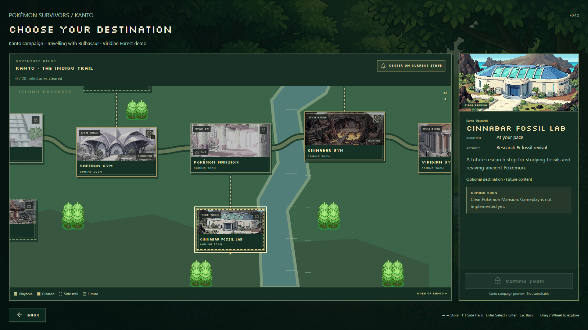
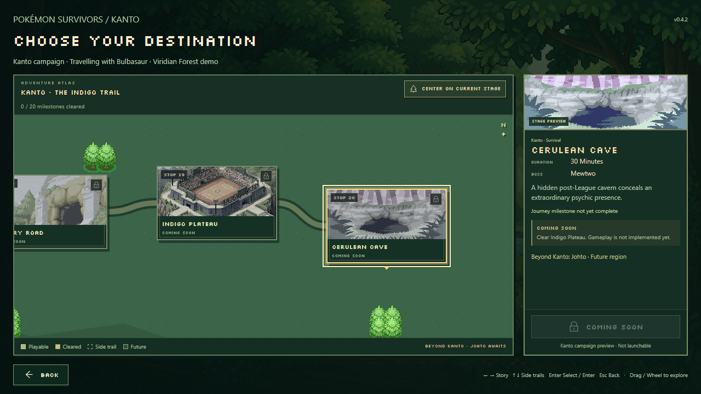

# Supplied campaign artwork

All 27 visible campaign locations now use the images supplied in the user's `Stage Art` folder, both on the map and in the selected destination panel. This includes the eight Gyms and all seven optional destinations. Viridian Forest reuses its identical existing PNG; 26 additional original files live in `public/assets/stages/`.

The runtime mapping is in [`src/campaign/artwork.ts`](../src/campaign/artwork.ts). [`assets/stages/imports.json`](../assets/stages/imports.json) records every original filename, stage ID, runtime path, dimension, byte count and SHA-256 hash. Images are copied byte-for-byte without cropping, resampling or recompression. `SS_Anne.jpg` is assigned to S.S. Anne as explicitly confirmed by the user.

Offscreen map cards use native lazy loading, while the selected detail artwork loads eagerly. Supplied art is labelled “Stage Preview” rather than “Art in Development”; Coming Soon / In Development gameplay status remains separate. Existing code-authored silhouettes remain available for future destinations without artwork.

Viridian Forest remains the only playable stage. This update changes no gameplay, campaign prerequisites, character selection or saved progression.

## Review evidence

TypeScript, the production build, all 267 unit tests and all 11 campaign browser checks passed. The artwork check selects every destination, verifies both decoded card/detail dimensions, checks the served file against its recorded SHA-256 hash and confirms that only Viridian Forest can launch. The production subpath check verifies all 27 image responses from `/pkmnsrvrs/`.

Screenshots were reviewed at 1280 × 720, 1600 × 900 and 1920 × 1080, including Gym, optional and late-campaign artwork. Detail text/actions fit without body overflow at those sizes. Image frames retain their existing landscape crop and the original source files remain intact. The production build retains Vite's existing large-chunk advisory.

