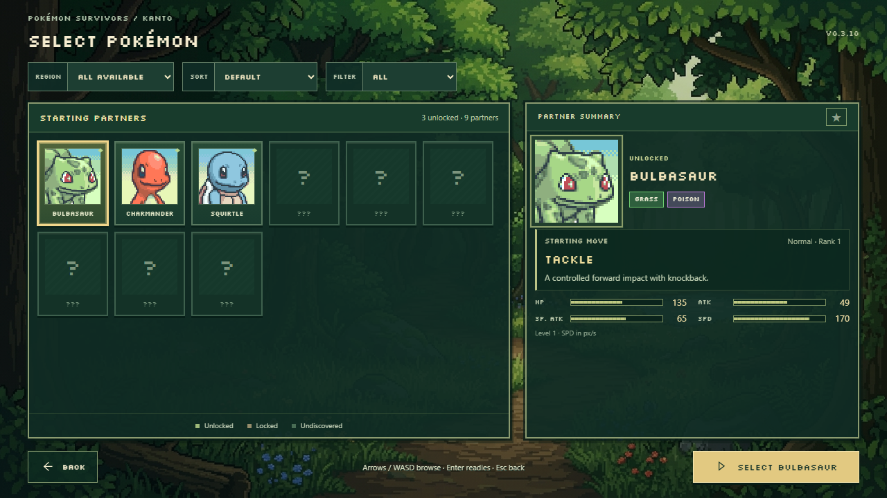
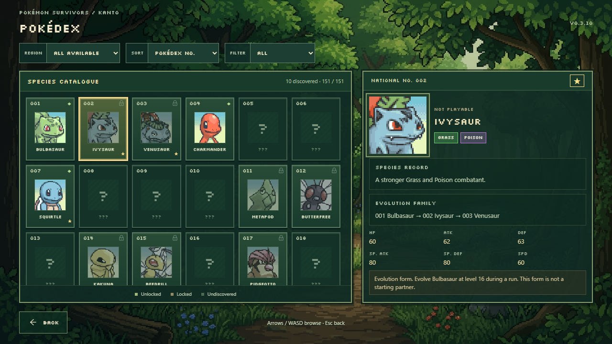

# v0.3.10 — base-form roster and compact partner summary

This corrects the existing two-column interface while retaining its portraits,
forest background, green pixel frames, gold selection border, types, Back, and
confirmation flow. No artwork or gameplay balance was changed.



[Charmander](qa/v0310/charmander.png) · [Squirtle](qa/v0310/squirtle.png) ·
[Locked starter](qa/v0310/locked.png) · [Undiscovered candidate](qa/v0310/unknown.png)

[1600 × 900](qa/v0310/roster-1600.png) ·
[1920 × 1080](qa/v0310/roster-1920.png) ·
[2560 × 1440](qa/v0310/roster-2560.png)

## Starting partners and evolution families

Character Selection now shows only actual registered base-form candidates:
Bulbasaur, Charmander, Squirtle, Caterpie, Weedle, Pidgey, Pikachu, Oddish, and
Bellsprout. It creates no empty character slots or dummy combat definitions.
Only the three existing starters are playable, subject to their saved unlocks.
Encounter-only and portrait-only candidates retain their locked/undiscovered
presentation and actual availability restrictions.

Eligibility follows pre-evolution links rather than an exclusion list of evolved
National Dex numbers. The source is the pinned [PokeAPI species dataset](https://github.com/PokeAPI/pokeapi/blob/f38eb24b70f8462976154f534e79bf2bdd7af847/data/v2/csv/pokemon_species.csv).
The original CSV, license, revision, and hash are archived under
`assets/data/pokeapi`; only the parent map is bundled into the application.

An earlier family member displaces a later form only when its region is
available. Thus Pikachu remains eligible while Johto/Pichu is unavailable, and
later-generation babies do not appear prematurely. Root species need no
evolution to qualify, so single-stage, Legendary, and Mythical candidates are not
excluded when their content and region are registered. Unit tests cover Pinsir,
Ditto, Snorlax, the legendary birds, Mewtwo, Mew, and future-baby gating.

This does not change in-run evolution, species definitions, research, discoveries,
unlocks, favorites, or save migration. Previously starred evolved forms remain in
the save and appear in the Pokédex; they do not become starting characters.

## Roster and summary corrections

- Character tiles show portrait, name, availability, and selection. National Dex
  numbers and the right-panel “National No.” heading are removed in this mode.
  Portraits use the same original files, with larger tile artwork.
- Compact Region/Sort/Filter selects replace region tabs. All available regions
  is the default; Johto/Hoenn remain disabled. Default ordering puts unlocked
  partners first. Alphabetical, Unlocked, Locked, Discovered, and Favorites work
  against the actual candidate registry. Selection stays stable while visible.
- The summary contains portrait/name/types, actual starting move and description,
  then compact numeric stat bars and relevant unlock information. Generic flavor
  descriptions are removed from Character Selection.
- HP, ATK, SP. ATK, SPD, rank, move type, description, and bar scales still come
  from the existing game data. HP uses actual starting run health; SPD uses
  movement pixels per second. No balance values were changed.
- Four stat indicators occupy two compact rows. Portraits scale to fit, and
  padding/gaps are reduced. The right panel uses visible overflow and has no
  scrolling container; content is sized to fit rather than hidden or clipped.
- Hover uses its own subdued border and never transfers keyboard focus. Clicking
  a tile or deliberate keyboard/controller navigation changes selection. Mouse
  travel across other tiles, into the summary, or toward Select leaves the chosen
  partner intact. Other menus retain their existing hover navigation.
- The primary Select button remains outside the roster and summary. Stage back
  restores the partner; all three starters still enter their correct real runs.

## Separate species Pokédex



The shared roster view has distinct character and Pokédex modes. The Pokédex
retains all 151 numbered Kanto slots, including separate evolved species,
discovered portraits, availability records, species notes, base stats where
implemented, and evolution-family information. Undiscovered identities remain
hidden. Missing/unimplemented records do not acquire invented stats or artwork.

Pokédex mode has no character confirmation action. Its left grid remains
scrollable to the final numbered entry. [Scrolled Pokédex](qa/v0310/pokedex-scrolled.png).
The character mode builds its own candidate list from registered content and
ancestry; it does not filter a collection of fabricated playable placeholders.

## Verification

Verified 2026-10-29:

- **136 Vitest tests passed.** Ancestry/root eligibility, later-generation babies,
  single-stage/Legendary/Mythical eligibility, existing unlock gates, actual stats,
  independent player selections, favorites, migration, simulation, and world checks.
- **39 Playwright-managed Chromium checks passed** in the full regression run.
  The roster checks cover base-only tiles, no character numbers, all starters,
  locked/discovered/unknown candidates, filters, sorting, stable mouse travel,
  keyboard/controller navigation, save preservation, correct real runs, missing
  portrait fallback, reduced motion, and the separate complete species grid.
- At **1280 × 720, 1600 × 900, 1920 × 1080, and 2560 × 1440**, every starter's
  portrait, name/types, starting move/description, and stats are inside the visible
  right panel. A locked starter's full unlock text is checked at each resolution.
  Tests compare child bounds, panel scroll/client heights, footer placement, and
  attempted scrolling: right-panel scrollTop remains zero. Nothing is clipped.
- Actual screenshots at all four sizes and with each starter selected were
  inspected for spacing, aspect ratio, readability, and original portrait use.
  Starter portrait Git hashes match the previous release.
- TypeScript and production build pass. The existing large Phaser bundle advisory
  remains; compilation succeeds.

[Roster diagnostics](qa/v0310/roster-diagnostics.json) show nine actual candidates,
one background controller, and no continuing tile animations.

```sh
pnpm typecheck
pnpm test
pnpm exec playwright test --output test-results/v0310-regression
pnpm build
```
