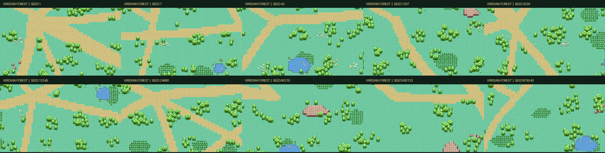
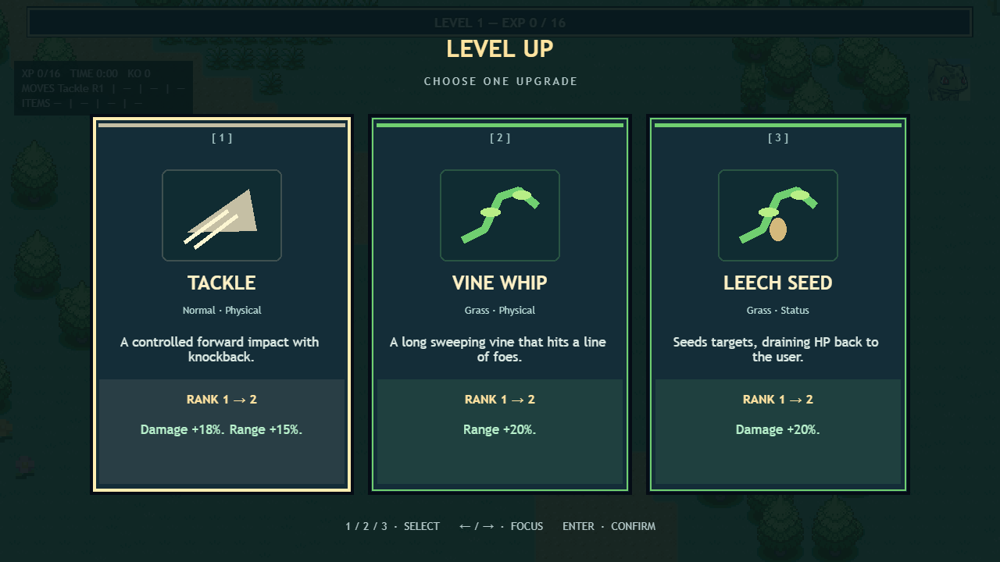
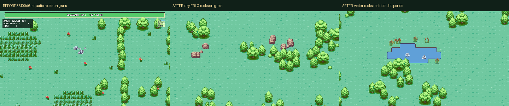

# v0.3.6 — world composition and progression UI

The level-up chooser now runs in its own Phaser scene, with a stationary camera
and a hit zone parented to each animated card. The former scrolling-world overlay
mixed world and UI coordinates. Each selection now locks immediately, checks its
request identity, applies one eligible upgrade to simulation state, and closes
before the next queued choice launches. Ordinary levels and mastery levels queue
independently. Mouse, 1/2/3, arrow focus, and Enter are supported; controller input
remains future work. Rewards with more than three options have pages.

Card illustrations use original Phaser drawing commands. Names, types, current
and next ranks, and benefit text come from actual content/rank calculations.
Simulation now honors cumulative damage multipliers, target/pierce/strike ranks,
seeded status and critical chances, absolute poison duration ranks, immediate HP
Up gains, Zinc projectile mitigation, and Sustain regeneration. An inverted
cooldown comparison is corrected: moves activate on their cooldown boundary
instead of almost every simulation tick. Knockback respects water and cliff
collision. Maxed moves,
items, vitamins, and masteries are excluded.

The top bar is 94% of the viewport and reads incremental `xp / nextXp`; the
simulation subtracts each completed level's requirement. A short interpolation
and level pulse resolve to the final state after consecutive levels. Level 100
has a full bar and an explicit maximum-level label. Damage and healing affect
only the small overhead HP bar. Its head position comes from the current PMD
frame's visible alpha bounds, including evolution and intentional elevation.
Full HP hides it automatically. The final-boss bar remains separate.

`src/renderSettings.ts` disables the entity shadow layer for players, wild
Pokémon, elites, and bosses. Ground anchors, interpolation, collision, sprite
scales, and environmental shading are preserved. The previous walk restart and
lower-body grass masking fixes remain in place.

## World generation

Normal run creation samples a new 32-bit seed once with `crypto.getRandomValues`.
`?seed=12345` pins a replay/test world; `?debug=1&seed=12345` displays its immutable
world seed separately from the evolving combat RNG. Results also display the
world seed. Generation, upgrade sampling, and combat use seeded randomness.

Viridian remains an 8192 × 8192 world with 256 streamed 512-pixel chunks. It is a
bounded world, not an infinite generator. A global seeded plan connects nine
varied clearings through bent trails and extra branches. Orientation, junctions,
widths, clearings, ponds, cliffs, camps, and the boss clearing change by seed.
Regional motifs span neighboring chunks. The renderer materializes the same
planned terrain regardless of viewing order and retains extra canopy margins.

The composition includes groves of three to eight trees, sparse undergrowth,
irregular tall-grass patches with brushing and ankle occlusion, clustered white,
pink, and yellow flowers, ponds with reeds and shore shadows, rocky formations,
and rare campsites with tents, logs, and supplies. Clearings and camps reserve
obstacle-free space. Camps have a minimum separation; the ancient-tree landmark
uses a clearing away from camps. Terrain and decoration collisions share the
navigation field. Pickups knocked into invalid terrain relocate to a reachable
cell, and uncollected balls persist when visual chunks unload.

## Reviewed assets

| Runtime class | Source and placement |
| --- | --- |
| `landRockSmall`, `landBoulder` | Complete dry formation at native cells `(0,13,3,3)` of the supplied FRLG sheet. Transparent grass removal; smaller version scales the whole formation. Dry terrain only. |
| `waterRock`, `shoreRock` | Existing gray FRLG aquatic crops, now restricted to water. Never selected for land rocks. |
| `cliffAtlas` | Nine native cells from the dry rocky formation, composed as tiled top, side, corner, center, and lower-face pieces. Cliff terrain blocks player and enemy movement. |
| Path/water atlases | 256 adjacency masks using FRLG textures and palette. Shore shadow sampling uses an extended neighborhood across tile borders. |
| Trees, bush, sapling, tall grass | Existing reviewed whole FRLG exports; transparent margins and ground anchors retained. |
| Tent, logs, supplies, reeds, flowers | Original code-authored pixel SVGs under `public/assets/environment/viridian/original`; native SVG source retained. |

The full 4,792-cell extraction library and archived source are preserved. New
runtime art does not relabel unverified cells in the full-sheet catalog.
`tools/audit_map_assets.py` renders SVGs through Chromium and includes them in
the runtime contact sheet. `tools/test_map_assets.py` verifies source equality,
complete silhouettes, grass leaves, land-rock pixels, and terrain adjacency.

## Validation and browser evidence

Verified on 2026-10-29: 113 Vitest tests, 20 Chromium Playwright tests, five Python
asset checks, TypeScript, and production build pass. The 400-enemy/10-second
simulation benchmark took 2.32 seconds in the final unit run. Vite retains its
existing large Phaser bundle warning; production compilation succeeds.

The 100-seed test checks real collision/navigation, connected path rasters,
reachable clearings and campsite approaches, usable spawn regions, legal water
and rock classes, impassable cliffs, and widespread navigation deadlocks. All
100 terrain fingerprints differ; the least collision-walkable world is 85.7%.
That metric measures collision cells, not visual canopy coverage. Explicit seeds
reproduce the whole plan, and two sampled seeds differ on more than 10% of their
terrain cells. Existing deterministic combat replay, stationary-player routing,
400-enemy, grass-brushing/masking, and movement restart tests remain enabled.

Playwright uses real card clicks at 960 × 540 and 2560 × 1440, keyboard choices,
consecutive level-up queues, mastery selection, double-click protection, actual
XP pickups, damage/healing, evolution, all shadow categories, reward collection
after chunk unloading, and actual movement against a cliff. An accelerated run
uses a controlled high-HP/high-power build and fixed simulation steps, defeats
Beedrill through combat, and verifies persisted victory and Mt. Moon unlock.
This is functional run coverage, not a normal-difficulty balance test.







Individual captures remain in `test-results/screenshots/v036-*`, including three
fresh normal runs, tall grass, flowers, camps, rocks, ponds, cliffs, groves, EXP,
damage, healing, evolution, cards, and victory. Regenerate with:

```sh
pnpm test
pnpm exec playwright test
pnpm build
python tools/test_map_assets.py
python tools/audit_map_assets.py
python tools/build_seed_gallery.py
```

The rock comparison's baseline was captured from an isolated archive of commit
`86f00d6`, with its original source and assets. `capture_baseline_rocks.mjs`
verifies the old HP HUD and rock category before capturing. The committed
baseline PNG preserves that evidence; the current checkout was never reset.
