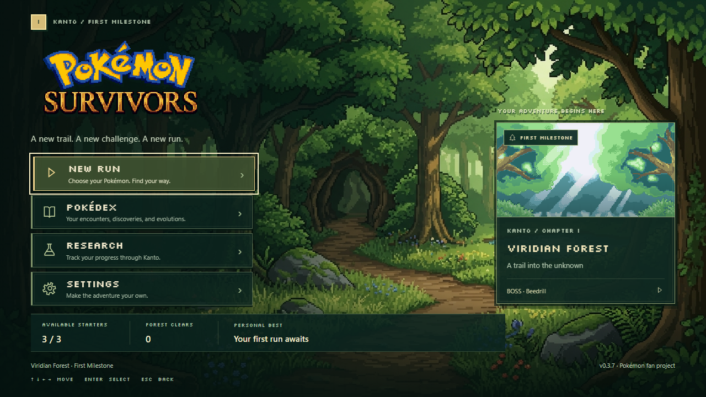
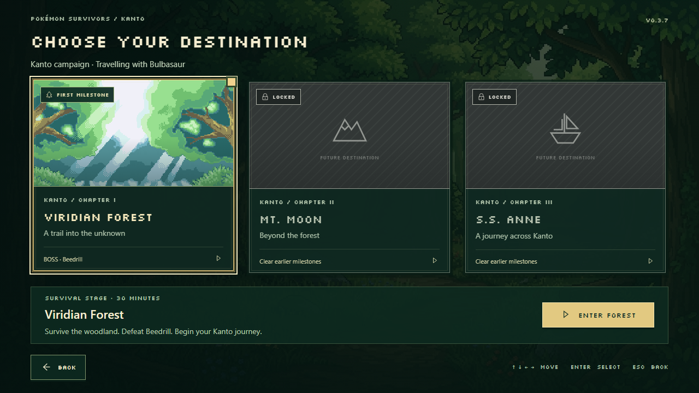
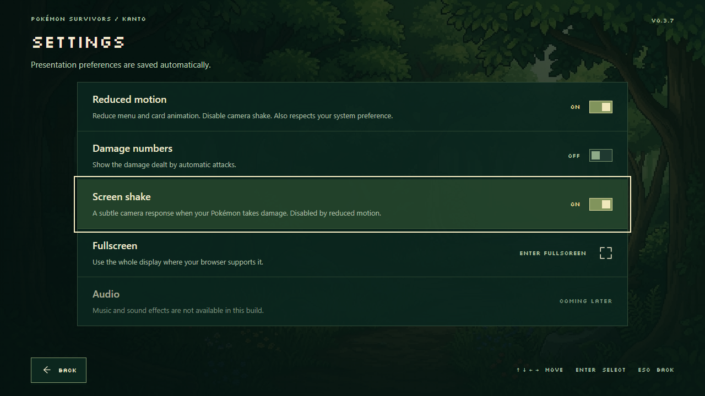

# v0.3.7 — Viridian Forest menu redesign

The title screen now uses the supplied forest background and Pokémon Survivors
logo, framed navigation, a featured milestone card, and actual save
statistics. Starter selection, stage selection, Pokédex, Research, and Settings
share the same forest palette and controls. The first milestone is **Viridian
Forest**. No gameplay terrain or procedural-generation assets were replaced.

## Imported artwork

| Supplied file | Imported file | Use |
| --- | --- | --- |
| `viridian_forest_main_menu.jpg` | `public/assets/menu/viridian-forest-main-menu.jpg` | 1376 × 768 main-menu background. Aspect-preserving cover, with shading concentrated behind navigation and the footer. |
| `FL_Viridian_Forest_card.png` | `public/assets/menu/viridian-forest-card.png` | 240 × 128 hero image in both the featured milestone and stage-selection cards. The frame retains the native 15:8 ratio and nearest-neighbor rendering. |
| `logo.png` | `public/assets/menu/pokemon-survivors-logo.png` | 202 × 100 transparent main-menu logo. Aspect-preserving responsive sizing replaces the text title. |

All three files are byte-identical imports. `assets/menu-imports.json` records their
original filenames, dimensions, roles, and SHA-256 hashes. Browser checks compare
the served image bytes with these hashes. The title screen contains no Pokémon
sprites, enemies, pickups, or gameplay overlays.

Silkscreen Regular/Bold is bundled locally with its SIL Open Font License in
`src/ui/fonts`. It comes from the [Google Fonts source repository](https://github.com/google/fonts/tree/main/ofl/silkscreen).
The imported artwork remains user-supplied material; no new redistribution rights
are asserted for it.

## Reusable components and navigation

- `src/menuScenes.ts`: Phaser scene lifecycle and the six frontend pages. The
  responsive DOM interface is mounted only during menu scenes and removed before
  gameplay. Starting a different menu also stops the previous menu's input loop.
- `src/menu.css`: typography, title treatment, artwork framing, menu controls,
  layout breakpoints, focus/pressed states, and restrained entrance animations.
- `src/ui/locationCard.ts`: one component reused for the main featured milestone
  and campaign cards. Its data includes id, title, subtitle, region, chapter,
  artwork, unlocked/completed/featured/playable states, boss, milestone, and
  description.
- `src/ui/menuData.ts`: stage metadata and truthful save/profile summaries.
- `src/ui/menuInput.ts`: spatial keyboard/controller focus. Mouse, Tab, arrows,
  WASD, Enter/Space, and Escape are supported. Controllers use D-pad/left stick,
  A/Start to select, and B to return. Held buttons cannot immediately activate the
  next scene. Browser APIs that disallow gamepads fail back to keyboard/mouse.

Viridian's completed state comes from recorded forest clears. Future locations
show explicit unavailable artwork and gameplay labels. Mt. Moon can be unlocked
by the existing save while remaining **in development**. Neither it nor S.S. Anne
can launch a nonexistent stage. New Run still selects a starter and then enters
the existing Viridian simulation.

## Settings and progress

Settings save automatically without replacing unlocks, best runs, or research.
Both current v2 and legacy v1 saves retain their existing progress:

- Reduced motion suppresses frontend transitions and card entrance motion and
  disables camera shake. The system's reduced-motion preference is also respected.
- Damage numbers control the existing automatic-attack number rendering.
- Screen shake enables a subtle response to actual player damage; it defaults
  off and is overridden by reduced motion.
- Fullscreen uses the browser's actual fullscreen state and reports unavailable
  support or a rejected request.
- Audio is clearly marked unavailable. There are no fake volume controls.

The footer reads the save's actual unlocked starter count, forest-clear count,
and best level/defeated count. It labels an empty record “Your first run awaits.”
Best-run ties now prefer more defeated Pokémon, then longer survival time, while
retaining the existing highest-level priority. Evolved discoveries are not
incorrectly counted as selectable starter families.

## Browser evidence

Verified on 2026-10-29: **119 Vitest tests, 26 Chromium Playwright tests,
TypeScript, and production build pass.** The full browser run includes all prior
gameplay regressions, the 100-seed world checks remain in Vitest, and the
accelerated Beedrill victory/save test remains green.

The subsequent logo import was checked with the two focused artwork/navigation
browser tests and a production build. All four main-menu resolutions retain the
logo's proportions and fit without horizontal or vertical scrolling.

[Full-resolution main menu at 2560 × 1440](qa/v037/main-menu-2560.png)

Full-resolution captures are in `test-results/screenshots/menu-*`: main menus at
1280 × 720, 1920 × 1080, 2560 × 1440, and 3440 × 1440; New Run/Pokédex focus;
partners; stage cards and selection; Research; Pokédex; and Settings. Canonical
screenshots finish finite entrance animations before capture.

Playwright checks real mouse/keyboard navigation into and out of subpages and
into gameplay, hash-identical artwork, focus/selection states, persistent settings,
actual damage-number and shake behavior, existing progress, fullscreen state,
and controller button sequences. Controller input is exercised through a virtual
Gamepad API device; a physical controller was not available for hardware testing.

Menu/subpage layouts are checked at 720p, full HD, and 1440p. The main menu also
fills ultrawide displays without stretching the art. Small windows use scrolling
and stacked cards instead of cutting off controls. Gameplay keeps its existing
1280 × 720 Phaser scaling and simulation.

Run `pnpm test`, `pnpm exec playwright test`, and `pnpm build` to validate. Existing
combat, progression, grass, movement, navigation, seeded geography, and complete-
run tests remain enabled. Audio, future-stage gameplay, and gameplay controller
movement remain outside this menu milestone. The existing Phaser bundle-size
warning is unchanged.
