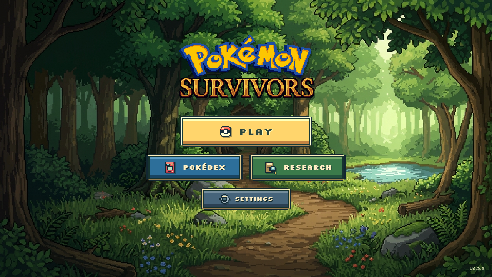
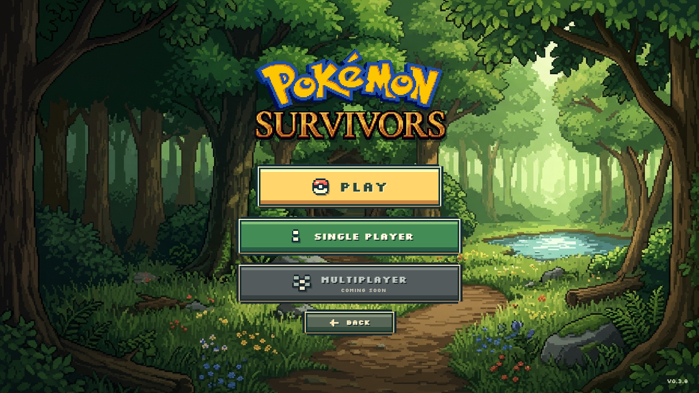

# v0.3.8 — centered arcade menu and living forest

The title screen now contains the existing custom logo, Play, a side-by-side
Pokédex/Research row, Settings, and a small version label. The old milestone copy,
tagline, location preview, button descriptions, and statistics panel are removed.
Gold, blue, green, and slate controls use stepped corners, cream trim, hard
dimensional shading, and original matching 24-pixel icons.

Play opens an animated mode picker inside the same scene. The logo and background
keep their positions and the background controller continues running. Single
Player enters the existing partner → stage → run flow. Multiplayer is disabled
and labeled Coming Soon; its future four-player target is isolated in
`PLAY_MODES`. There is no lobby or networking implementation. Back, Escape, and
controller B close the picker and restore Play focus.

Viridian Forest artwork and reusable location cards remain on Stage Selection,
with Kanto/Survival/30 minutes/Beedrill metadata and real completion/unlock states.
Unavailable stages remain unavailable. Personal bests and saved totals now live
in Research's functional Statistics view; Challenges remain available in the
other tab. No progress values are invented or replaced.

## Animation implementation

`MenuBackgroundController` is owned and updated by the Phaser menu scene. A
separate viewport Canvas 2D surface draws the original image and atmospheric
layers behind the DOM controls. This keeps ultrawide rendering independent of
the gameplay canvas's 1280 × 720 scaling. The source JPG, logo PNG, and location
PNG are unchanged.

- `menuBackgroundMath.ts`: a continuous 32-second pan cycle, approximately four
  source pixels horizontally and two vertically, with 1.025 overscan. Rendering
  snaps to whole viewport pixels and disables image smoothing. Unit tests check
  every edge through two complete cycles at all four target resolutions.
- `menuAmbientParticles.ts`: an independent decorative RNG, at most ten small
  pixel leaves, gently curved trajectories, natural fading, and seven faint
  illuminated motes. It never reads or advances the simulation RNG.
- `menuLightingController.ts`: one cached soft illumination mask anchored to
  the already-lit clearing, with a faint independent lighting cycle. It does not
  distort the illustration or draw obvious beam triangles.
- `menuBackgroundController.ts`: Phaser delta time, explicit pause/resume,
  document visibility, resize handling, reduced motion, optional future layer
  inputs, diagnostics, and deterministic resource cleanup on scene shutdown.

Background motion is intentionally subtle. Nearest-neighbor, whole-pixel
sampling keeps the art crisp, with occasional one-pixel position changes rather
than fractional-pixel blur. Gameplay rendering/filter settings are untouched.

Reduced motion uses static framing, hides leaves/motes, disables light animation,
and removes entrance motion while preserving focus indicators. System preference
changes are handled while the menu is open. Repeated scene navigation releases
the decorative canvases, pixel/lighting buffers, observers, and event listeners.
The canvas does not intercept pointer input. Proper transparent depth layers can
be supplied through `setLayers`; none were fabricated from the flat illustration.

Independent branch/foliage sway remains a future asset task: it needs vegetation
masks or separated foreground layers with clean plates behind them. This pass
uses the supported full-image motion and atmospheric overlays instead.

## Navigation repairs and files

- `menuScenes.ts`: centered title layout, mode routing, and Research tabs.
- `ui/titleMenu.css`, `arcadeButton.ts`, `pixelIcons.ts`: arcade presentation,
  responsive sizing, and code-authored icons.
- `ui/menuInput.ts`: spatial navigation now prefers controls whose perpendicular
  extents overlap. Down from Play reaches the two-button row; Right moves between
  Pokédex and Research instead of jumping diagonally to Settings.
- `ui/runResultsScene.ts`: the existing run results now use a stationary UI scene.
  Return to Menu is clickable regardless of the gameplay camera's scroll. Enter
  and Escape also return. Gameplay simulation and result persistence are unchanged.
- `e2e/helpers/menu.ts`: shared menu readiness and Single Player navigation.
  Game-canvas selectors explicitly target `#app canvas` to exclude the decorative
  canvas during browser checks.

## Actual browser evidence





[2560 × 1440 menu](qa/v038/main-2560.png) ·
[3440 × 1440 menu](qa/v038/main-ultrawide.png) ·
[Stage Selection](qa/v038/stage-selection.png)

**[32-second actual animation recording](qa/v038/menu-ambience.webm)**

The reviewed VP9 clip removes browser startup from the Playwright-managed Chromium
capture. Sampled beginning/middle/end frames were inspected for sharpness, scene
alignment, leaf density, lighting, and exposed edges. The artwork is not cut up or
warped; the UI stays stationary. Loop closure and continuous framing are also
checked numerically. [Frame diagnostics](qa/v038/animation-diagnostics.json) record
34 samples over 33.83 simulation seconds: median render-loop rate 60.5 FPS, lowest
sample 59.2 FPS, at most ten leaves, and about 0.09 ms average JavaScript drawing
submission per frame. The recording itself is encoded at 25 FPS; these figures
are local observations, not a cross-device performance guarantee.

The raw recording and additional screenshots (focus states, Pokédex, Research,
Settings, and reduced motion) remain under `test-results/screenshots/v038-*`.

## Verification

Verified 2026-10-29:

- **127 Vitest tests**, including seeded replay, 100 forest seeds, navigation,
  progression, menu geometry, cycle/edge coverage, clock behavior, and statistics.
- **30 Chromium checks**: 29 in the full regression run plus the separate recording
  test. These cover four resolutions, actual menu input, mode/back behavior,
  controller navigation, disabled multiplayer, saves/settings, reduced motion,
  pause/resume, repeated scene cleanup, starting/returning from runs, grass/movement,
  level-up cards, and an accelerated real Beedrill victory.
- TypeScript and production build pass. The existing large Phaser bundle warning
  remains; compilation succeeds.

```sh
pnpm test
pnpm exec playwright test --grep-invert "motion recording"
pnpm exec playwright test e2e/menuBackground.spec.ts --grep "motion recording"
pnpm build
```

Audio, physical controller hardware testing, and multiplayer networking remain
outside this milestone. Existing supported settings and all stage/world content
remain intact.
