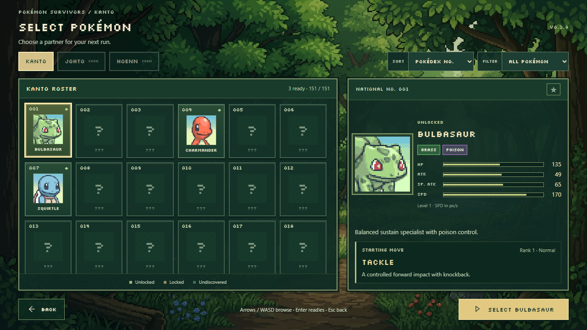

# v0.3.9 — Pokémon character roster

The partner screen now uses a compact, scrollable portrait roster and a dedicated
selected-Pokémon panel. Existing Bulbasaur, Charmander, and Squirtle portraits
remain the primary artwork in both places. Their files are unchanged; no new
Pokémon art, overworld substitutions, or forest replacement was introduced.



[Charmander](qa/v039/charmander.png) · [Squirtle](qa/v039/squirtle.png) ·
[1920 × 1080](qa/v039/roster-1920.png) ·
[2560 × 1440](qa/v039/roster-2560.png) ·
[Undiscovered and locked states](qa/v039/unknown.png) ·
[Scrolled catalogue](qa/v039/scrolled.png)

## Presentation and browsing

- Six columns on the requested desktop resolutions; five on narrower desktop
  windows, with a stacked layout on small screens. The roster scrolls internally.
- Gold selected frames, hover/focus feedback, National Dex numbers, visible
  locked/discovered states, and a large portrait in a separate pixel frame.
- Kanto active; Johto and Hoenn explicitly unavailable. Region definitions use
  National Dex ranges 1–151, 152–251, and 252–386. The same region handler can
  select additional implemented regions when their registry flag is enabled.
- Sorting by National Dex or visible name. Undiscovered names never participate
  in alphabetic ordering ahead of known partners. Selection survives reordering.
- All, Unlocked, Discovered, and Favorites filters. Empty favorites have a clear
  empty state and disable confirmation. The star button persists favorites as
  National Dex IDs in the existing save. No unlock dates are fabricated for a
  “recently unlocked” sort.
- Arrow keys/WASD and the existing controller input browse the roster, scroll
  focused tiles into view, and update details. Native selects retain keyboard
  control; controller left/right cycles their values. Enter/Space on a roster
  tile moves focus to the primary confirmation button. A second confirmation
  continues. Mouse clicks on tiles only preview a partner.
- One Select button opens Stage Selection. Back from Stage Selection restores
  the selected partner and the scene's sorting/filter state. The title menu's
  existing Single Player mode picker and Back/Escape flow remain intact.

The supplied forest is visible behind the panels. Both the title and partner
scenes reuse the same local foliage, pond, and light-ray controller. Reduced
motion freezes the forest and disables tile/detail motion. Scene shutdown
releases background buffers, observers, input listeners, and view listeners.

## Actual game values

The detail panel reads `POKEMON` and `MOVES`, including the real starting rank 1.
`startingStats` supplies level-one values to the simulation and UI. HP includes
the simulation's existing ×3 health multiplier; SPD is actual world movement in
pixels per second, rather than the separate canonical base-speed stat.

| Partner | Starting HP | ATK | SP. ATK | SPD (px/s) | Starting move |
| --- | ---: | ---: | ---: | ---: | --- |
| Bulbasaur | 135 | 49 | 65 | 170 | Tackle |
| Charmander | 117 | 52 | 60 | 185 | Scratch |
| Squirtle | 132 | 48 | 50 | 155 | Tackle |

Meters use maxima across the actual registered Pokémon definitions: HP 240,
ATK 84, SP. ATK 109, and SPD 205. These scales remain consistent across selections
and recalculate from the registry when definitions change. Move descriptions
come from the implemented survival-combat move records.

## Progression and scale

The screen contains 151 numbered Kanto **catalogue slots**, not 151 playable
character definitions. Twenty existing species have portrait/catalogue metadata;
the remaining slots have no name, combat data, move, portrait request, or playable
unlock. They stay mystery entries. There are no invented character stats.

Only the existing three starter definitions are configured as starting partners,
and each still requires its actual `unlockedPokemon` entry. `pokedex` discovery
reveals an implemented species' identity and portrait without making it playable.
Evolution forms remain available through their existing in-run evolutions.
Encounter-only and portrait-only species display an explicit unavailable state
after discovery. No new research reward or unlock challenge was invented.

Confirmation rechecks the current save. Injecting an evolution or enemy ID into
the unlock list does not enable that species as a starting character. Existing
v1/v2 save migration, research, best runs, discoveries, stages, and settings are
preserved. The optional `favoritePokemon` field does not change the save version.

`CharacterSelection` holds a player ID, indicator color, preview Dex ID, confirmed
Dex ID, and ready state. Instances are independent and allow duplicate selections.
There is no core player-count limit, lobby, network connection, or simulated
multiplayer state in this milestone.

The grid uses lightweight DOM tiles and lazy portrait loading; mystery tiles do
not fetch art. There are no per-tile animation loops. The actual browser test
browses all 151 slots and reaches the final row while keeping a single background
controller and zero animated tiles. [Diagnostics](qa/v039/roster-diagnostics.json)
retain the measured count and scroll position. The registry builder is also
tested with 386 catalogue slots without generating fake playable definitions.

An absent portrait displays “Portrait unavailable” and emits one explicit warning
for that asset. It never falls back to a different Pokémon or gameplay sprite.

## Verification

Verified 2026-10-29 with Playwright-managed Chromium:

- **133 Vitest tests passed**, including registry boundaries, availability gates,
  independent selection state, real starting stats, favorites, and save migration.
- **37 browser checks passed** in the complete regression run. The six new roster
  checks cover all three original portraits, live stats/types/moves, preview and
  confirmation behavior, locked/unknown/unavailable states, scrolling, keyboard,
  sorting/filtering/favorites, old-save preservation, portrait-error fallback,
  reduced motion, stage back, and actual gameplay for each starter. Existing
  controller, world, combat, evolution, upgrade, and victory checks still pass.
- Screenshots captured at 1280 × 720, 1920 × 1080, and 2560 × 1440, plus each
  starter selected. Actual renders were reviewed for clipping, alignment,
  readability, original portrait use, and spacing. Detail panels fit without
  internal scrolling at the requested desktop sizes.
- TypeScript and production build pass. Vite still reports the pre-existing large
  Phaser bundle advisory; compilation succeeds.

```sh
pnpm typecheck
pnpm test
pnpm exec playwright test --output test-results/v039-regression
pnpm build
```

Implementation: `src/ui/characterRoster.ts`, `characterRosterView.ts`,
`characterRoster.css`, `src/playerStats.ts`, and the existing menu/input/save flow.
