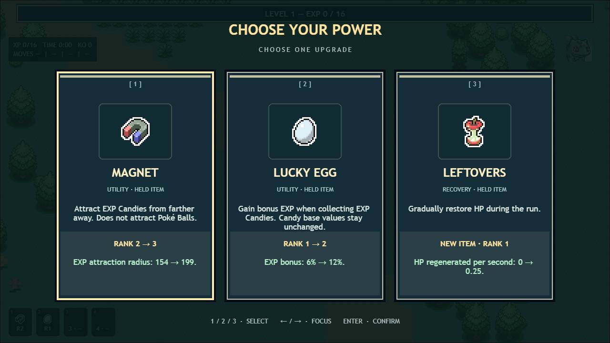
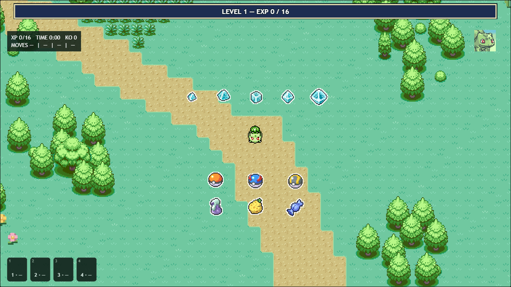

# v0.4.0 — Items and EXP Candies

This pass replaces the eight-item effect union and instant 32-unit EXP collection with a shared item engine, 40 held items and fixed-step candy homing. Existing PMD Pokémon art, FRLG terrain, character selection, move illustrations, save version 2, ball reward counts, vitamins and the EXP curve remain in use.

## Assets and architecture

146 local PokéSprite PNGs at pinned revision `c5aaa610ff2acdf7fd8e2dccd181bca8be9fcb3e` cover 82 mappings, including all available outlines. See [the asset manifest](../assets/ASSET_MANIFEST.md) for exact paths, byte hashes, attribution and the distinction between the MIT code license and copyrighted Pokémon imagery. No assets are hotlinked.

- `items.ts`: stable IDs, rank scaling, caps, categories, rarity, applicability, offer weights and shared card formulas.
- `itemCombat.ts`: direct/status damage, healing, incoming damage, survival protection, stagger and successful-attack triggers.
- `pickupSystem.ts`: authoritative homing, local stationary-candy merging, collection and seeded consumable drops.
- `pickupRenderer.ts`: interpolation, time-based bob/pulse, shared sparkle drawing, visible hazard warnings and collection feedback. Shared textures, no per-candy tweens or emitters.
- `itemAssets.ts` / `data/pokespriteAssets.ts`: exact local art mapping and shared preload. `ui/itemHud.ts`: four icons, slot numbers, ranks, spent-Sash state and hover descriptions.

## Attraction and EXP

Every Pokémon attracts candies within **64 world units** and collects within **18**. Magnet ranks 1–5 extend attraction to **109 / 154 / 199 / 244 / 289**. Candies accelerate at 700 units/s² from an initial speed of 30 toward a distance-dependent speed of 140–360; they latch once triggered, follow the moving Pokémon and float over obstacles. Rendering interpolates the 30 Hz simulation positions. Level-up overlays freeze attraction and decorative time.

Magnet does not change candy value, EXP yield, Electric damage or ball collection. Zap Plate is the Electric booster. Lucky Egg adds 6% EXP per rank at collection; feedback displays the bonus and the source candy retains its base value. Fractional bonus EXP is preserved internally and formatted for display.

| Candy | Base EXP |
|---|---:|
| XS | 1–8 |
| S | 9–24 |
| M | 25–59 |
| L | 60–149 |
| XL | 150+ |

Stationary candies within 18 units can merge, retaining total value and promoting their visual tier. In-flight candies, balls and consumables do not merge. Drops persist through chunk unloading. Enemy EXP values remain unchanged; elites and bosses now leave their defined EXP candy in addition to their existing ball reward. Victory still completes immediately when the boss is defeated.

## Forty held items

Four slots; standard items rank 1–5. Values below are per rank unless explicitly described as totals. The cards derive their exact old/new numbers and trigger rules from the same definitions as simulation aggregation.

| Item | Effect |
|---|---|
| Silk Scarf | Normal move damage +10% |
| Charcoal | Fire move damage +10% |
| Mystic Water | Water move damage +10% |
| Zap Plate | Electric move damage +10% |
| Miracle Seed | Grass move damage +10% |
| Never-Melt Ice | Ice move damage +10% |
| Black Belt | Fighting move damage +10% |
| Poison Barb | Poison move damage +10% |
| Soft Sand | Ground move damage +10% |
| Sharp Beak | Flying move damage +10% |
| Twisted Spoon | Psychic move damage +10% |
| Silver Powder | Bug move damage +10% |
| Hard Stone | Rock move damage +10% |
| Spell Tag | Ghost move damage +10% |
| Dragon Fang | Dragon move damage +10% |
| Black Glasses | Dark move damage +10% |
| Metal Coat | Steel move damage +10% |
| Pixie Plate | Fairy move damage +10% |
| Magnet | Attraction +45 units above baseline 64 |
| Leftovers | Restore 0.25 HP/s |
| Scope Lens | +3% direct-hit critical chance; crits deal 1.5× damage |
| Quick Claw | Automatic move cooldown −4%; minimum cooldown 0.15s |
| Big Root | +15% draining recovery, including direct and sustained Leech Seed healing |
| Lucky Egg | +6% collected candy EXP |
| Shell Bell | +0.25 HP after a successful damaging attack; shared 0.6s cooldown |
| Rocky Helmet | Return 2 damage to a contact attacker; shared 0.5s cooldown |
| Focus Sash | Rank 1 only: survive one fatal hit per run at 1 HP, with 0.8s grace; spent item retains its slot |
| Focus Band | +4% seeded fatal-hit survival chance; 12s cooldown after success, 0.25s grace |
| Float Stone | Movement speed +3%; stacks multiplicatively with Carbos |
| Muscle Band | Physical move damage +6% |
| Wise Glasses | Special move damage +6% |
| Expert Belt | Super-effective move damage +8% |
| Wide Lens | Impact/corridor tolerance +6 units above baseline 8; catches nearby secondary targets, eight-hit cap |
| Light Clay | Supported clouds, poison, burns, seeds and slows last +12% longer |
| Binding Band | Supported poison, burn and seed damage over time +12% |
| Assault Vest | Ranged hit damage −8% |
| Safety Goggles | Enemy powder, powder-projectile and poison damage −16% |
| Heavy-Duty Boots | Spike damage and spike movement penalty −16% |
| Life Orb | Move damage +10%, successful move costs 0.5% max HP; shared 0.25s cooldown; recoil cannot reduce HP below 1 |
| King's Rock | Direct-hit stagger chance +3%; normal stagger 0.18s with 1s immunity, elites 0.12s; bosses 0.06s with 2.5s immunity |

Type boosts also scale supported damage-over-time source power without rounding away small bonuses. Fixed-style Dragon Rage ignores offensive Pokémon stats but can benefit from applicable item modifiers. Multi-target healing/recoil triggers are shared per move rather than repeated for each hit.

Butterfree powder projectiles can inflict three seconds of poison (2 HP/s), and its windup produces a visible powder patch. Later Beedrill phases create visible spike patches. All patches warn for 0.75s, expire after 6s and share a 24-patch cap. Spikes deal 8 HP/s and slow by 30%; powder deals 4 HP/s. Goggles and Boots have real underlying sources to mitigate. Ordinary tall grass retains its existing movement behavior. Protective grace is finite and regeneration never revives a defeated Pokémon.

Unusable type/class/effect items are filtered against equipped moves and learnable moves while a move slot is open. Currently missing move types do not become meaningless offers just to expose all 18 boosters. All 18 work in the generic combat engine and are covered by damage tests. Equipped items receive upgrade preference; active move types and draining builds receive relevance weighting; recovery weight increases below half HP. Four occupied slots exclude new items. Weighted draws use the existing seeded RNG and remove selected entries to avoid duplicates.

## Vitamins, consumables and balls

The six vitamins retain their original effects and rank-10 limit, use medicine sprites and take no held-item slots. No inventory panel is added.

| Ground consumable | Effect |
|---|---|
| Potion / Super Potion / Hyper Potion | Restore 20 / 50 / 100 HP |
| Oran Berry / Sitrus Berry | Restore 10 HP / 25% max HP |
| Full Restore | Restore max HP and remove player statuses |
| Lum Berry | Remove supported player statuses |
| Rare Candy | Add one current-level EXP threshold, respecting Level 100 |

Useless healing/cure pickups remain available on the ground. Normal enemies have a seeded 4% consumable-drop chance; elites 12%, followed by weighted selection favoring ordinary healing. Rare Candy has the lowest weight. Balls use Poké / Great / Ultra artwork and retain original seeded one/three/five-choice reward rules and 32-unit contact collection. Magnet does not pull them.

Save compatibility uses existing item IDs, including `magnet`. The current save stores progression/unlocks rather than an in-progress held build, so no destructive migration or reset is required. Character choices and PMD portraits are unchanged.

## Verification

The automated pass covers all 40 effects through damage, movement, status, trigger or collection hooks; applicability, weighting, caps, consumables, source-byte hashes, deterministic replay, merging and EXP conservation. Browser coverage includes actual PNG texture keys, all five candy tiers, homing/interpolation, rank updates, card layout, overlay pauses, reduced motion, world consumables, 600 rendered candies with stable texture counts and recorded baseline/Rank-1/Rank-5 walking demonstrations.

Screenshots, the asset gallery, performance measurements and a short WebM are generated under `test-results/v040-visual/` by `e2e/items.spec.ts`. Reviewed release evidence is archived in [`qa/v040/`](qa/v040/).

### Verified results — October 29, 2026

- TypeScript and the production build pass; the existing large Phaser bundle advisory remains.
- **211 Vitest tests pass**, including 75 item/asset/pickup cases. The combined 400-enemy + 600-candy test completed three simulated seconds in **261.8 ms**, preserving all **3,900 EXP** after Lucky Egg. A separate dual deterministic 600-candy replay completed in 7.8 ms with identical state hashes.
- The full **47-case Chromium regression suite passed** with one browser worker. After the final badge sizing and hover/tooltip changes, **16 focused Chromium checks passed**, covering the item suite, two added visual bounds/combat-feedback cases and the six upgrade/EXP regressions. There are **49 distinct passing browser cases** in the expanded suite.
- At 1280 × 720, 600 actual candy images retained **218 shared textures before and after**. The final isolated run measured a **22.1 ms median / 24.8 ms p95** frame interval (reported game-loop FPS 51.1). Measurements describe this machine and fixture, rather than a hardware-independent guarantee. Walking with the camera preserved remaining candy value plus awarded EXP; no duplicate award or texture growth occurred. See [raw measurements](qa/v040/dense-performance.json).
- The first full run with seven browsers competing for GPU/CPU missed one frame-time bound and exposed a fixed-loading-delay assumption in an old test. That test now waits for the opening encounter state. The full rerun used one worker; performance bounds were retained.
- Actual screenshots were inspected for all five candy tiers, balls, consumables, all imported art, four item ranks, Magnet/Lucky Egg values, vitamins, offensive/defensive/utility/rare cards, type boosts and combat/hazard feedback. Visual review caught the source type badges being 128 px; they now scale proportionally to 32 px, and browser bounds tests keep them inside their cards. Move illustrations remain intact.
- A roughly 14-second [gameplay recording](qa/v040/candy-attraction.webm) demonstrates baseline, Rank 1 and Rank 5 candy homing while walking, with untouched ball drops. It is an explicitly labelled developer fixture using Level 50 to keep the demonstration free of upgrade pauses. Normal progression is tested separately.





```sh
pnpm typecheck
pnpm test
pnpm exec playwright test --workers=1 --output test-results/v040-full-serial
pnpm exec playwright test e2e/items.spec.ts e2e/v036.spec.ts --workers=1 --output test-results/v040-final-cards
pnpm build
```
