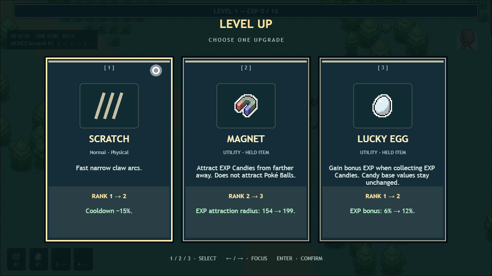
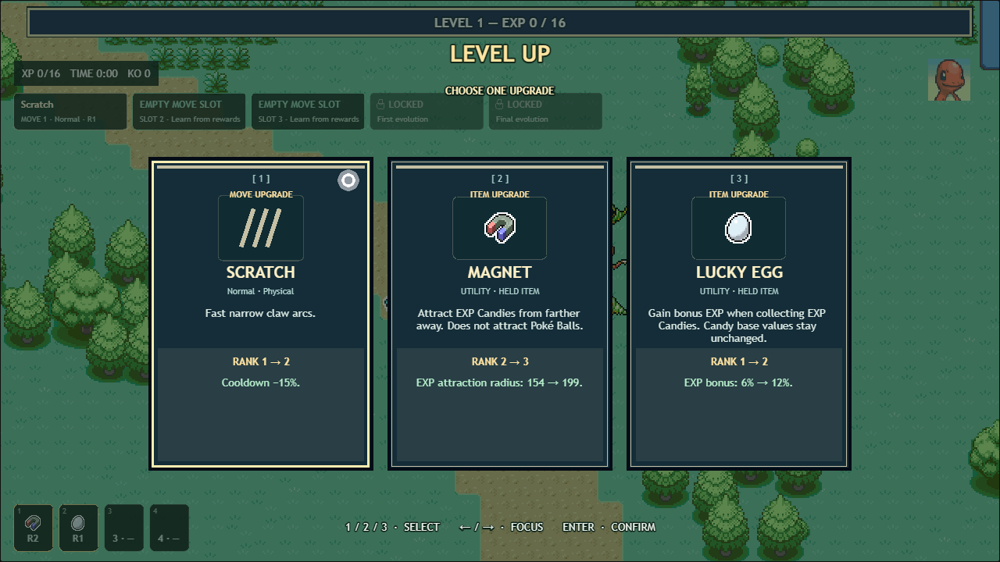
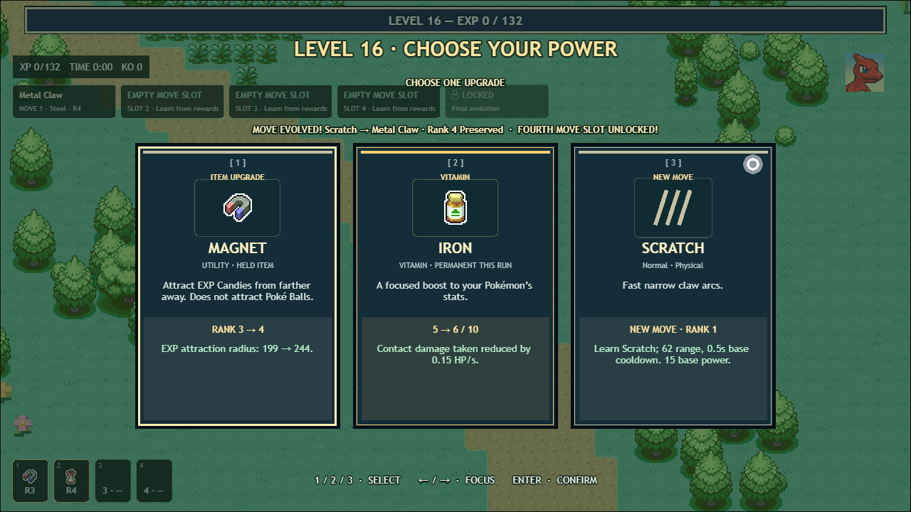
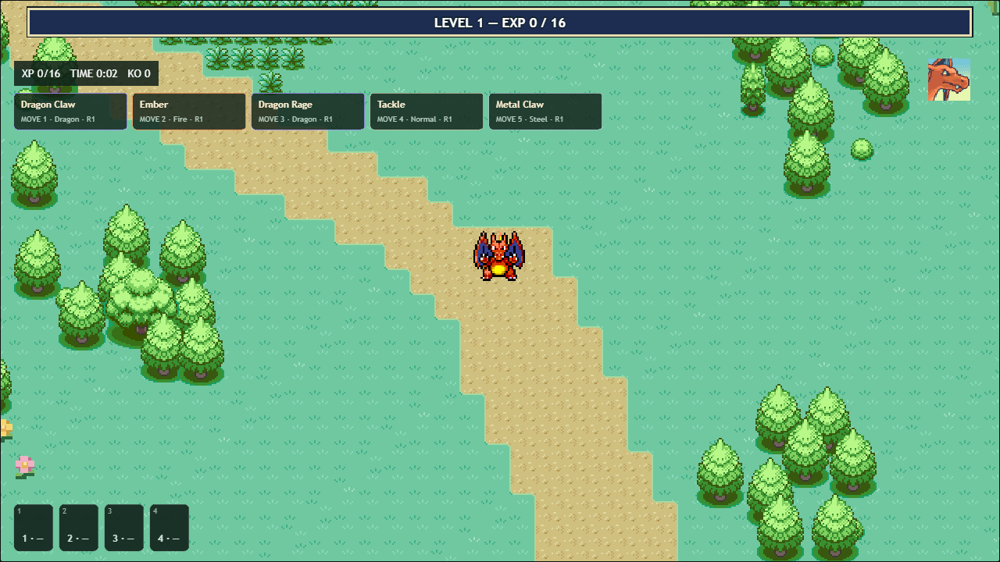

# v0.4.1 — Evolution move progression and upgrade polish

Move capacity, starter move transformations and upgrade drafts now follow evolution progress. The v0.4.0 item engine, PokéSprite import, EXP Candy homing, PMD Pokémon assets, FRLG map, saves and existing menus remain in use.

## Move slots and progression data

`src/moveProgression.ts` is the shared capacity/lock-requirement helper used by simulation eligibility, item relevance and the five-slot move HUD. Family stage is data, independent of whether a later evolution is caused by a level, an item or an alternate branch. Future species can supply `moveProgression: {stage, stages}` without adding species-specific checks to the engine. The current nine starter-family records use the central registry; this pass adds no playable roster entries.

| Family | Base | Evolved | Final / later milestone |
|---|---:|---:|---:|
| Three stages | 3 | 4 | 5 on final evolution |
| Two stages | 3 | 4 | Evolved form reaches 5 at Level 40 |
| No evolution | 3 | 4 at Level 20 | 5 at Level 40 |

A two-stage base form must evolve before accessing its final two slots; its fifth-slot requirement reads “Evolve + Level 40.” Locked slots show a small padlock and their requirement. Available empty slots remain empty until the player chooses a move reward. All equipped moves can still rank up while capacity is full. The separate held-item HUD remains exactly four slots.

## Starter transformations

Rules in `src/moveEvolution.ts` specify source species, target species, source move and target move. `evolveTo` applies the transition shared by current level evolution and future explicit target triggers.

| Family | Starter | First evolution | Final evolution |
|---|---|---|---|
| Charmander | Scratch | Metal Claw · Steel | Dragon Claw · Dragon |
| Bulbasaur | Tackle | Vine Whip · Grass | Razor Leaf · Grass |
| Squirtle | Tackle | Water Gun · Water | Hydro Pump · Water |

The designated starter retains its move-slot object, rank and cooldown state. For example, Scratch R4 becomes Metal Claw R4 and then Dragon Claw R4. Other equipped moves, items, vitamins and EXP retain their investment. Evolution retains the existing health/stat changes and Pokémon presentation. The HUD and item relevance use the new move's identity/type immediately.

When the target move already exists, the two copies merge at the higher rank. Redundant selections return as **move-choice credits** instead of disappearing. Tackle R4 + Vine Whip R3 becomes one Vine Whip R4 plus three credits: two redundant rank investments and the redundant learned-move selection. These are selected through move-only reward cards after ordinary queued rewards, while the game stays paused. If the build has no eligible move choice, credits remain banked for a later unlock instead of generating invalid cards. No item rank or unrelated move is reset.

The configurable rule format also supports keeping the same move identity with an explicit damage bonus; the existing three starter chains use identity transformations only.

Metal Claw and Dragon Claw use distinct silver/dragon claw hits. Razor Leaf uses piercing leaf impacts; Hydro Pump uses a broad water jet and splash. All four definitions use the existing typed damage, critical-hit, item, target and rank framework. Final starter learnsets contain enough implemented moves to fill five slots.

## Drafts, ranks and timing

The first weighted draw is reserved for an equipped move or held-item improvement whenever one is available. Remaining cards use the normal weighted pool, so items, new moves and vitamins remain meaningful choices. Every selected entry is removed from the pool; eligibility is checked again when applying a selection. New moves require an unlocked vacancy, while max-rank choices are excluded. Draws remain seeded and deterministic.

Cards explicitly label **NEW MOVE**, **MOVE UPGRADE**, **NEW ITEM**, **ITEM UPGRADE**, **VITAMIN** or **MASTERY**, alongside the existing numeric rank transition.

`moveRankStats` supplies the rank-derived values used by cards and combat. The rank audit fixed these previously incomplete cases:

- Dragon Rage's `power` modifier is a supported rank property. Its rank-two base damage changes from 32 to 37; later ranks change only their configured range, cooldown or target count. There is no hidden automatic damage increase at every rank.
- Poison Powder's count modifier increases the actual cloud target limit from eight to sixteen at Rank 5. Its duration and status chance remain authoritative.
- Area modifiers scale the effective radius; status duration scaling applies consistently to supported statuses.
- Piercing attacks use the actual corridor through their primary target, with Wide Lens widening that corridor and impact tolerance.

Each move retains its own next activation time and effective cooldown duration. Rank upgrades, Quick Claw and move transformations preserve the remaining fraction when cooldown duration changes; they do not reset the whole move or cause an immediate extra attack. Rendering remains separate from the 30 Hz simulation.

## Selection pause and compact UI

Opening a level-up, mastery or ball choice immediately pauses the gameplay Phaser scene. That freezes sprite frames, simulation, world brushing, pickups, projectiles, particles, tweens, timers and scheduling. The Upgrade scene has its own input and animation clock. Queued selections and refunded move choices resolve without any intermediate gameplay resume.

After the final choice, the fixed-step accumulator is cleared and keyboard states are reset before one resume, preventing missed-frame catch-up and stuck movement keys. Cancelling a choice or returning from a finished run cleans up the paused scene and overlays. Gameplay grass timing uses simulation time, so its phase also stays continuous across a selection.

The overlay is **55%** dark green. Cards are **280 × 394** at 1280 × 720, with smaller proportional art, a dedicated action label and measured text fitting. Keyboard focus, hover lift, clicks, Enter/1–3 selection, special-reward pagination and reduced motion remain available. Evolution/move-slot announcements sit below the move HUD; the existing evolution presentation resumes after the reward queue.

Consumables use **1.25×** scaling: their original transparent 32px frames contain 20–24px silhouettes, producing **25–30 visible world pixels**. EXP Candies and balls retain their 2× art, animation and attraction behavior. Collection radii are unchanged (consumables 20, candy 18, balls 32).

## Visual evidence and verification

The before image was captured from `bc3b640` over a seeded Charmander battle before editing. Updated browser evidence and diagnostics are archived in [`qa/v041/`](qa/v041/).

| Before | After |
|---|---|
|  |  |





Validation includes progression capacities, both transformations for all three starters, duplicate-rank refunds, unchanged item/vitamin investment, shared combat/card rank values, seeded replay, every card's bounds, frozen sprite/timer/tween state, queued decisions, one final resume and unchanged consumable collection mechanics. The content-layout audit measures all **65** move, item, vitamin and mastery cards.

### Verified October 30, 2026

- **249 Vitest tests passed**, including 34 progression/rank cases and the existing 75 item/asset/pickup cases. The four new attacks are also included in the shared all-moves simulation checks.
- **58 Playwright Chromium checks passed** in the final complete regression run, including nine new progression/UI cases. Coverage includes actual frozen player/enemy frames, pickup positions, clock, timer and tween state; uninterrupted queued pauses; refunded move choices; one final resume; pagination and reduced motion; and exiting a paused choice before starting a clean new run.
- **TypeScript and the production build passed.** The existing large Phaser bundle advisory remains.
- All **65 card definitions** fit their 280 × 394 bounds without description/rank/benefit overlaps. [Card bounds](qa/v041/card-layout-diagnostics.json), [evolution state](qa/v041/evolution-diagnostics.json) and [actual attack events](qa/v041/attack-diagnostics.json) are archived with the screenshots.
- At 1280 × 720, 600 candy images retained **228 shared textures before and after**. The final two-worker browser run measured a **25.5 ms median / 29.6 ms p95** frame interval; [raw measurements](qa/v041/dense-performance.json) describe this machine and fixture. The unit stress test combined 400 enemies with 600 homing candies for three simulated seconds in 312.2 ms and preserved all 3,900 EXP after Lucky Egg.
- Before/after battle screenshots, both Charmander evolutions, all four new attacks, full/locked move slots, reduced-motion pagination and smaller consumables were visually inspected. Runtime PMD, FRLG and PokéSprite asset files have no changes in this release.

```sh
pnpm typecheck
pnpm test
pnpm exec playwright test --workers=2 --output test-results/v041-full-final
pnpm build
```
