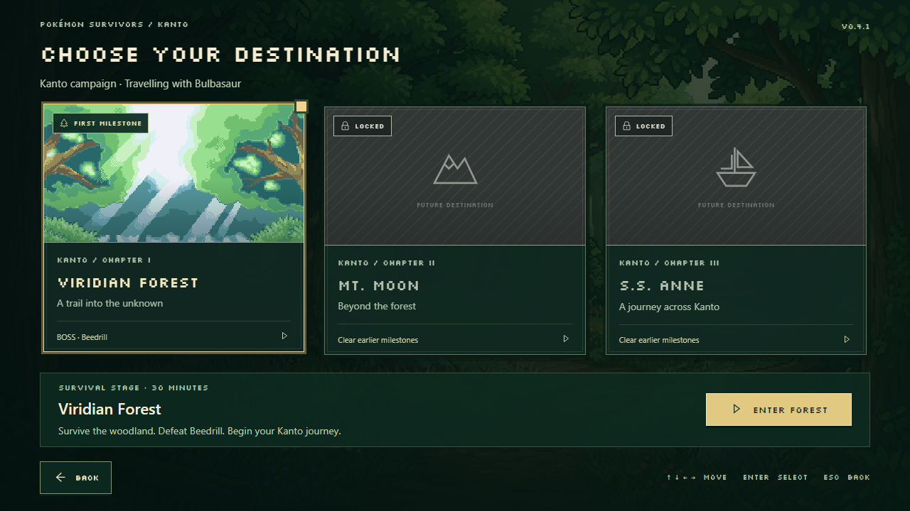
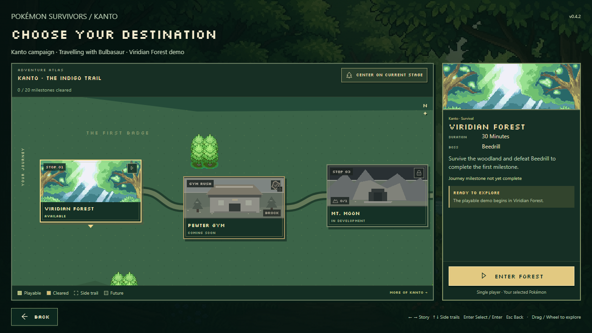
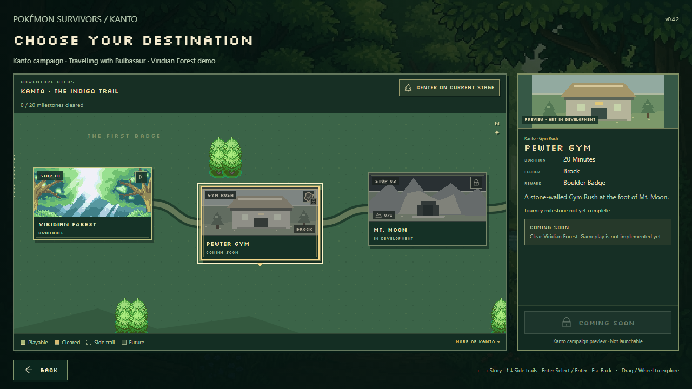
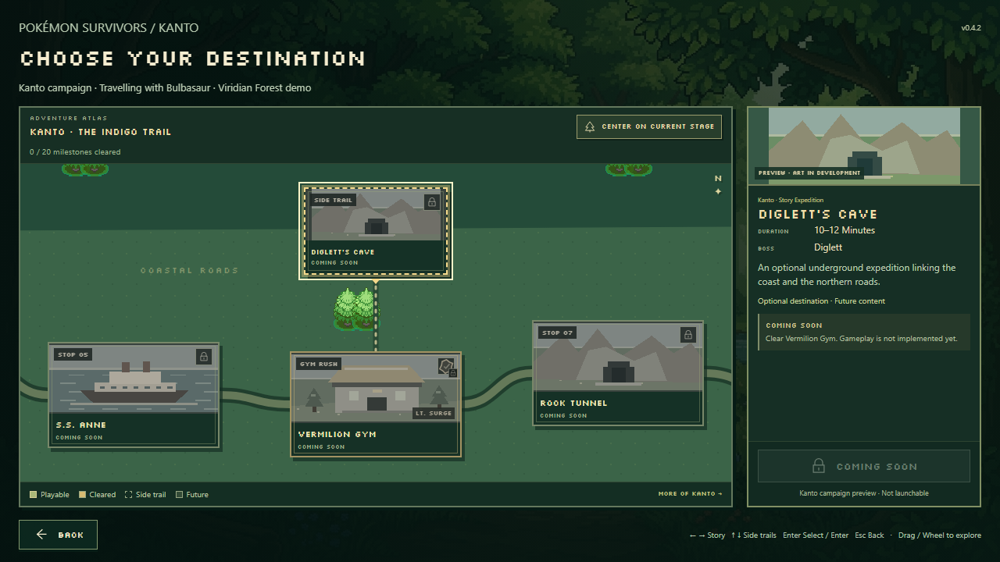
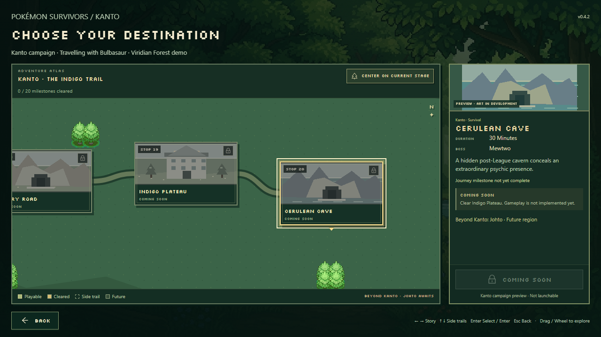

# v0.4.2 — Kanto adventure atlas

Stage Selection now presents a connected, horizontally scrolling Kanto journey. The old three-card grid, its component/data helper and its unused styles are removed. **Viridian Forest remains the only playable stage.** Every other visible destination is an information preview with a disabled launch action.

## The journey

Twenty mandatory stops form one uninterrupted left-to-right route. Main cards are 220 × 136 pixels, with gentle vertical offsets and curved trails. Optional cards are 184 × 112 and connect vertically with thinner, dotted paths.

| Stop | Destination | Encounter / reward | Duration |
|---:|---|---|---|
| 1 | Viridian Forest | Beedrill | 30 minutes |
| 2 | Pewter Gym | Brock · Boulder Badge | 20 minutes |
| 3 | Mt. Moon | Clefable | 30 minutes |
| 4 | Cerulean Gym | Misty · Cascade Badge | 20 minutes |
| 5 | S.S. Anne | Rival encounter | 30 minutes |
| 6 | Vermilion Gym | Lt. Surge · Thunder Badge | 20 minutes |
| 7 | Rock Tunnel | Onix · story expedition | 10–12 minutes |
| 8 | Rocket Hideout | Arbok / Weezing | 30 minutes |
| 9 | Celadon Gym | Erika · Rainbow Badge | 20 minutes |
| 10 | Pokémon Tower | Ghost Marowak | 30 minutes |
| 11 | Safari Zone | Kangaskhan | 30 minutes |
| 12 | Fuchsia Gym | Koga · Soul Badge | 20 minutes |
| 13 | Silph Co. | Nidoking | 30 minutes |
| 14 | Saffron Gym | Sabrina · Marsh Badge | 20 minutes |
| 15 | Pokémon Mansion | Ditto | 30 minutes |
| 16 | Cinnabar Gym | Blaine · Volcano Badge | 20 minutes |
| 17 | Viridian Gym | Giovanni · Earth Badge | 20 minutes |
| 18 | Victory Road | Machamp | 30 minutes |
| 19 | Indigo Plateau | Elite Four / Champion | 30 minutes |
| 20 | Cerulean Cave | Mewtwo · future route toward Johto | 30 minutes |

Seven visible optional trails attach to their story parents: Diglett’s Cave to Lt. Surge, Celadon Game Corner to Rocket Hideout, Power Plant to Koga, Fighting Dojo to Silph Co., Seafoam Islands to Sabrina, Cinnabar Fossil Lab to Pokémon Mansion, and Mt. Ember to Blaine. All remain Coming Soon.

Cerulean Garden, Nugget Bridge and Vermilion Harbor have future starter-challenge definitions and prerequisites, but are omitted from this demo's rendered map. Starter selection still offers the same three existing starters.

Mt. Moon Fossil Chamber and Pokémon Mansion Secret Laboratory are **hidden in-stage discoveries**, not selectable nodes or optional routes. Their parent cards/details show discovery counts, initially 0/1. Only explicit saved discovery IDs increase those counts; clearing or unlocking a stage does not invent a discovery. Dungeon gameplay is not implemented.

## Navigation and presentation

- Click a destination to inspect it in the anchored side panel. Enter or controller Confirm on the selected playable node enters the existing forest; future nodes remain selectable for information.
- Drag the map in either axis. The wheel travels horizontally; Shift + wheel moves vertically. Native scroll bounds prevent empty travel beyond the atlas.
- Left/right follows the main route. Up/down enters or leaves attached side trails. Escape / controller Back returns to the selected partner. Tab can reach the independent panel and center controls.
- “Center on current stage” returns to Viridian Forest in the demo. Selection focuses the camera with restrained native easing; reduced motion removes easing and decorative entrance animation.
- When space permits, camera framing includes a selected parent and its optional destination together. The selected card remains visible at the tested resolutions.

The palette uses dark emerald, cream, earth tones and muted gold with the existing Silkscreen fonts. Gym cards have bronze frames, Gym Rush labels, leader names and a badge symbol with a separate locked/recorded state. Selected cards receive gold outlines; completed trails illuminate gold.

Viridian uses the original supplied location image. The atlas initially shipped with code-authored SVG silhouettes for future locations; the subsequent [Stage Art import](STAGE_ART.md) replaces them with the user's supplied images for all 27 visible destinations. Silhouettes remain available for future locations without artwork. The atlas backdrop reuses complete existing FRLG tree props, with original SVG terrain, rivers and mountain silhouettes. The main-menu painting is not reused as every destination thumbnail.

The side panel includes the location artwork, region/type, duration, boss or leader, badge reward where applicable, description, completion, requirement/build status and primary action. The action remains visible without scrolling the whole screen; the required details fit at 1280 × 720, 1600 × 900 and 1920 × 1080.

## Progress and implementation are separate

`resolveCampaignNode` resolves story requirements, saved unlocks, completion, discoveries and actual implementation independently. Beedrill's defeat satisfies Brock's future story requirement, but Pewter Gym remains Coming Soon and non-launchable. Existing `mtMoon` / `ssAnne` and other future unlocks are preserved, including the historical unlock that predates the newly inserted gyms.

Optional `completedStages` and `discoveredLocations` arrays extend save version 2 with safe defaults. New victories append a completed stage; legacy Viridian win totals and historical last-run victories still resolve completion. Existing starters, favorites, unlock arrays, research and best runs are retained. This view never rewrites save progress merely because a preview was selected.

No extra stage, trainer battle, starter quest, hidden dungeon, multiplayer mode or region gameplay is added. Stage launch has both implementation gating in the view and the existing Viridian-only dispatch in `StageScene`.

## Changed structure

| File | Responsibility |
|---|---|
| `src/campaign/data.ts` | Campaign graph, encounters, durations, prerequisites, future quests and hidden discovery definitions |
| `src/campaign/layout.ts` | Separate node placement, connectors, graph navigation and curve sampling |
| `src/campaign/state.ts` | Pure saved-progress/availability resolution |
| `src/ui/campaignView.ts` | Atlas assembly, selection, shared keyboard/controller navigation and contextual focus |
| `src/ui/campaignViewport.ts` | Bounded panning, wheel/drag handling, reduced-motion focus and cleanup |
| `src/ui/campaignNode.ts` | Node state, gym symbols and discovery markers |
| `src/ui/campaignPaths.ts` | SVG trails and backdrop composition |
| `src/ui/campaignArt.ts` | Original pixel preview illustrations and existing forest art |
| `src/ui/campaignDetail.ts` | Selected location information and launch gate |
| `src/ui/campaign.css` | Atlas layout, visual states and responsive styles |
| `src/menuScenes.ts` / `src/ui/menuData.ts` | Stage scene integration, existing partner hand-off and frontend version |
| `src/content.ts` | Shared visible campaign metadata replaces the incomplete 14-location registry |
| `src/save.ts` | Compatible completion/discovery fields and victory recording |
| `src/menu.css` | Old card-grid and summary styles removed |
| `src/ui/locationCard.ts` | Removed obsolete component |

Campaign data, layout, save resolution and presentation are independent. A separate region fixture is rendered and navigated in the browser to verify there are no required Kanto node IDs in the view. Future regions can provide their own graph, trail labels and layout configuration without changing the current demo's launch scope.

## Review evidence

The previous selector was captured from commit `25ee61b` before editing. Updated screenshots and measured panel/viewport bounds are archived in [`qa/v042/`](qa/v042/).

| Before | New atlas |
|---|---|
|  |  |







Validation covers ordering, all bosses/badges/durations, optional parentage, non-crossing connectors, bounds, graph navigation, saved wins/unlocks/secrets, disabled future launches, real partner/forest/result navigation, drag suppression, keyboard/controller input, reduced motion, view re-entry, three resolutions and a production build served from `/pkmnsrvrs/`.

All checks passed: TypeScript, 267 unit tests, all 68 Chromium browser tests and the production build. The browser suite includes the real forest launch from `/pkmnsrvrs/`, legacy saves, controller/back navigation and the existing gameplay regressions.

Screenshots were reviewed at 1280 × 720, 1600 × 900 and 1920 × 1080. Selected cards and their details/action remain visible, the detail body has no overflow at those sizes, and optional trails remain separated from the main route. The archived `responsive-diagnostics.json` records the measured bounds. The production build retains Vite's existing large-chunk advisory.

```sh
pnpm typecheck
pnpm test
pnpm build
pnpm exec playwright test --workers=2 --output test-results/v042-full
```
